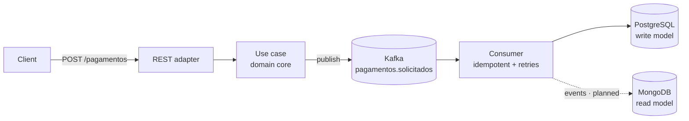

# Thallis Ferreira

**Backend Engineer — Java · Spring Boot · Event-Driven Architecture**
Building backend systems for the financial sector · Recife, Brazil

[LinkedIn](https://www.linkedin.com/in/thallis-ferreira-dev-java/) · [Email](mailto:thallis.ferreira2019@gmail.com)

---

### About

Backend engineer at **Accenture**, with 4 years building services for banks and large enterprises
(previously at **NTT DATA**, working with Bradesco, Banco PAN and AB InBev).
My work sits where reliability matters most: payment flows, credit products, customer notifications and
system integrations that can't afford to lose a message.

I focus on **hexagonal architecture**, **asynchronous messaging** and **systems that are easy to change**,
and I care about understanding *why* an architectural decision is made, not just how to implement it.

→ Full experience on [LinkedIn](https://www.linkedin.com/in/thallis-ferreira-dev-java/).

---

### Featured project

#### 💳 [payments](https://github.com/THenriqueh/async-payment-system) — asynchronous payment processing, PIX-style

A reference implementation of how I'd design an instant-payment backend: idempotent, event-driven,
and built so the domain doesn't depend on any framework.

**Implemented**
- **Hexagonal architecture** — domain core with no framework dependencies; REST and Kafka live in adapters behind ports
- **Asynchronous flow** — the API accepts the payment request and publishes it to Kafka; processing happens in a separate consumer
- **Idempotency** — duplicate requests and redelivered messages don't produce duplicate payments
- **Retries** — failed processing is retried instead of losing the message
- **Partitioning** — `pagamentos.solicitados` with 3 partitions, keyed to preserve ordering per payment

**Next**
- **CQRS** — MongoDB read model fed by domain events, separate from the PostgreSQL write model
- **Resilience** — circuit breakers with Resilience4j
- **Observability** — metrics and dashboards with Prometheus and Grafana, centralized logs with ELK
- **Cloud** — deployment on AWS (ECS, RDS)

**Stack:** Java 21 · Spring Boot · Kafka (KRaft) · PostgreSQL · Docker · *(planned: MongoDB, Resilience4j, AWS)*

**Status:** 🚧 in active development

- [x] Local infrastructure with Docker Compose (Kafka KRaft, PostgreSQL, Kafka UI)
- [x] Topic design — `pagamentos.solicitados`, 3 partitions
- [x] Domain model and hexagonal package structure
- [x] Payment use cases + REST adapter
- [x] Kafka consumer, idempotency and retries
- [ ] CQRS read model
- [ ] Observability stack
- [ ] AWS deployment

---

### Tech

| Area | Tools |
| --- | --- |
| **Languages & frameworks** | Java (8 → 21), Spring Boot, Spring Data JPA / Hibernate |
| **Messaging & integration** | Apache Kafka, Apache Camel, RabbitMQ, REST, OpenAPI |
| **Data** | PostgreSQL, MongoDB, SQL |
| **Security** | OAuth2, JWT, Keycloak |
| **Cloud & DevOps** | AWS, Docker, Jenkins, Git (GitHub, GitLab, Bitbucket) |
| **Observability** | Datadog, Prometheus, Grafana |
| **Architecture** | Hexagonal / Clean Architecture, microservices, event-driven design |

---

### Certifications & education

- **AWS Certified Cloud Practitioner** — Amazon Web Services
- *In progress:* AWS Certified Developer – Associate
- Systems for Internet — Universidade Católica de Pernambuco (UNICAP)

---

Currently studying distributed systems, system design and Kubernetes. Open to conversations about backend roles in fintech and banking.
