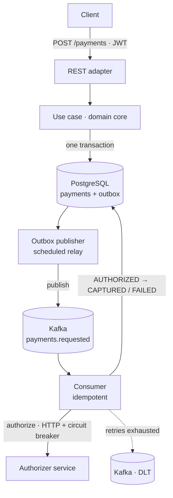

# Thallis Ferreira

**Backend Engineer — Java · Spring Boot · Event-Driven Architecture**
Building backend systems for the financial sector · Recife, Brazil

[LinkedIn](https://www.linkedin.com/in/thallis-ferreira-dev-java/) · [Email](mailto:thallis.ferreira2019@gmail.com)

---

### About

Backend engineer at **Accenture**, 4 years building services for banks and large enterprises (before that at **NTT DATA**: Bradesco, Banco PAN, AB InBev). I work mostly on payment flows, credit products and system integrations, with Java, Spring Boot and Kafka. Lately I've been going deeper into hexagonal architecture, event-driven design and distributed systems.

→ Full experience on [LinkedIn](https://www.linkedin.com/in/thallis-ferreira-dev-java/).

---

### Featured project

#### 💳 [async-payment-system](https://github.com/THenriqueh/async-payment-system) — asynchronous payment processing, PIX-style

A PIX-style instant-payment backend: async, event-driven, idempotent, and resilient when the authorizer goes down.

**Implemented**
- **Hexagonal architecture** — domain core with no framework dependencies; REST, Kafka, HTTP and persistence live in adapters behind ports
- **Fast ingress, async settlement** — the API accepts and records the payment (`202 Accepted`); settlement runs later in a separate Kafka consumer
- **Rich domain model** — a state machine (`REQUESTED → AUTHORIZED → CAPTURED / FAILED`) with invariants enforced inside the aggregate
- **Idempotency, two layers** — a unique idempotency key stops duplicate requests, and the consumer skips already-processed payments, so Kafka's at-least-once delivery never double-charges
- **Outbox pattern** — the payment and its event are written in a single transaction; a scheduled relay publishes to Kafka, so no event is lost between the DB commit and the broker
- **Circuit breaker** — calls to an external authorization service (a second Spring Boot service) are wrapped with Resilience4j, failing fast with a fallback when it's down
- **Dead letter queue** — processing that keeps failing is retried with backoff and routed to a DLT instead of being dropped
- **JWT authentication** — stateless security with a custom filter; login issues a signed token, and every request is validated before it reaches a controller
- **Partitioning** — `payments.requested` with 3 partitions, keyed by payment id to preserve per-payment ordering
- **Automated tests** — unit tests for the domain and application layers (JUnit, Mockito), plus an integration test that boots Postgres and Kafka with Testcontainers

**Next**
- **CQRS** — MongoDB read model fed by domain events, separate from the PostgreSQL write model
- **Observability** — metrics and dashboards with Prometheus and Grafana, centralized logs with ELK
- **Cloud** — deployment on AWS (ECS, RDS)

**Stack:** Java 21 · Spring Boot 3 · Kafka (KRaft) · PostgreSQL · Resilience4j · JWT · Docker · *(planned: MongoDB, AWS)*

**Status:** 🚧 in active development

- [x] Local infrastructure with Docker Compose (Kafka KRaft, PostgreSQL, Kafka UI)
- [x] Hexagonal domain model and package structure
- [x] REST API — create + query payments, with global error handling
- [x] Async flow — outbox publisher + idempotent Kafka consumer
- [x] Resilience — circuit breaker, retries and dead letter queue
- [x] External authorization service (service-to-service HTTP)
- [x] JWT authentication (stateless, custom filter)
- [x] Automated tests (unit + integration with Testcontainers)
- [ ] CQRS read model (MongoDB)
- [ ] Observability stack
- [ ] AWS deployment

---

### Tech

| Area | Tools |
| --- | --- |
| **Languages & frameworks** | Java (8 → 21), Spring Boot, Spring Data JPA / Hibernate |
| **Messaging & integration** | Apache Kafka, Apache Camel, RabbitMQ, REST, OpenAPI |
| **Data** | PostgreSQL, MongoDB, SQL |
| **Security** | OAuth2, JWT, Keycloak |
| **Cloud & DevOps** | AWS, Docker, Jenkins, Git (GitHub, GitLab, Bitbucket) |
| **Observability** | Datadog, Prometheus, Grafana |
| **Architecture** | Hexagonal / Clean Architecture, microservices, event-driven design |

---

### Certifications & education

- **AWS Certified Cloud Practitioner** — Amazon Web Services
- *In progress:* AWS Certified Developer – Associate
- Systems for Internet — Universidade Católica de Pernambuco (UNICAP)

---

Currently studying distributed systems, system design and Kubernetes. Open to conversations about backend roles in fintech and banking.
